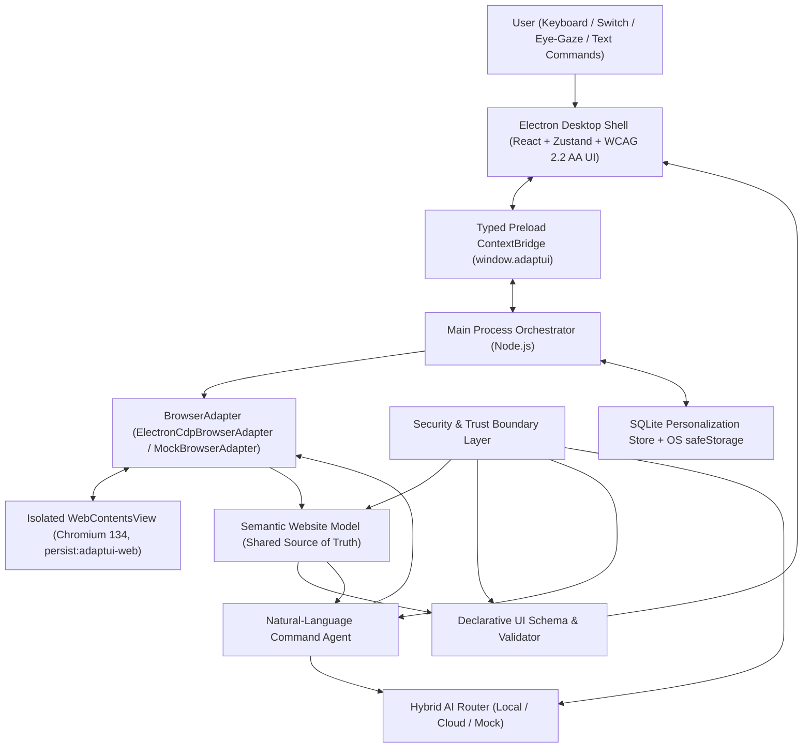

# AdaptUI Architecture Overview

## 1. System Diagram

---

## 2. Module Responsibilities

| Package | Responsibility |
|---|---|
| `@adaptui/shared-types` | Versioned TypeScript interfaces for the Semantic Website Model, Browser Snapshots/Actions, Accessibility Profiles, AI/Privacy Config, Command Plans, Diagnostics, and IPC contracts. |
| `@adaptui/security` | Prompt-injection detection & sanitization, untrusted-data framing, URL scheme enforcement (`http`/`https` only), sensitive-field redaction, consequential-action risk classification, and remote AI payload scrubbing. |
| `@adaptui/semantic-model` | Zod schemas and deterministic `extractSemanticPage` pipeline merging CDP Accessibility Trees and DOM metadata, tracking page revisions, detecting stale references, and preserving form constraints. |
| `@adaptui/ui-schema` | Strict declarative UI specification (18 approved component primitives), deterministic & AI-assisted layout generator, and safety validator rejecting ungrounded actions, missing required fields, or confirmation downgrades. |
| `@adaptui/accessible-ui` | Reusable WCAG 2.2 AA React component library (`AccessiblePage`, `AccessibleTaskStep`, `AccessibleDialog`, etc.) with CSS-variable profile theming, reduced motion, high-contrast modes, eye-gaze sizing, and switch-scanning focus cycling. |
| `@adaptui/browser-core` | Pluggable `BrowserAdapter` interface, `ElectronCdpBrowserAdapter` (native CDP `1.3` + `backendDOMNodeId` resolution + outcome verification), and `MockBrowserAdapter` for deterministic tests. |
| `@adaptui/ai-core` | Provider-neutral `AIProvider` interface and `HybridAIRouter` enforcing local-only privacy locks, privacy flags, capability checks, retries, timeouts, cancellation, context bounds, and redacted logging. |
| `@adaptui/ai-providers` | Concrete adapters for Ollama (`/api/chat`, `/api/tags`), OpenAI-compatible APIs, Anthropic Messages API, Google Gemini API, and `DeterministicMockAIProvider`. |
| `@adaptui/command-agent` | Natural-language execution pipeline: intent interpretation -> semantic grounding -> bounded multi-step plan -> confirmation gate -> browser execution -> state refresh -> verification -> accessible feedback. |
| `@adaptui/personalization` | SQLite persistence (`sql.js` atomic file writes) for Accessibility Profiles, AI/Privacy settings, consent-gated evaluation metrics, reversible personalization advisor, and `SecretStore` abstraction. |
| `@adaptui/desktop` | Electron desktop application combining the React shell, isolated `WebContentsView`, OS `safeStorage` credential store, embedded local fixture server, and `electron-builder` packaging. |

---

## 3. Core Architectural Invariants

1. **Shared Source of Truth:** Both reconstructed UI controls and natural-language commands bind exclusively to `SemanticPage.actions`.
2. **Declarative UI Only:** AI models never output executable HTML/JS; the renderer rejects any component or action not validated against `AccessibleUISpecSchema` and `SemanticPage`.
3. **Authoritative Original Session:** The embedded `WebContentsView` retains live cookies, authentication, and DOM state across view switches.
4. **Grounded & Verified Execution:** Every browser action re-resolves its target and checks post-action URL/DOM deltas rather than assuming success.
5. **User Control over Consequential Actions:** Purchases, payments, deletions, messages, security changes, and non-search form submissions always require explicit user confirmation.

---

## 4. Risk Register

| Risk | Severity | Mitigation |
|---|---|---|
| Prompt injection embedded in webpage text or `aria-label` | High | Stripped & flagged in `extractSemanticPage`, wrapped in `<untrusted_website_content>` tags for AI, and confirmation policies are enforced deterministically outside the LLM. |
| Stale element references after SPA/DOM updates | High | Every `ElementReference` carries `(pageId, revision)`; `ElectronCdpBrowserAdapter` resolves `backendNodeId` first with semantic role/name fallback and refreshes `SemanticPage` after every step. |
| Remote AI data leakage in local-only mode | Critical | `HybridAIRouter` structurally omits `cloudProvider` when `routingMode === "local-only"` or `privacy.allowRemotePageContent === false`, verified by unit tests. |
| Cross-origin iframes / `<canvas>` apps | Medium | Detected and reported in `SemanticPage.unsupportedFeatures` and `incompleteNotice`, offering one-click fallback to the live Original Website view. |
| Cross-platform native build drift | Medium | Pure-WASM SQLite (`sql.js`) eliminates native C++ ABI rebuild issues; macOS/Linux builds remain explicitly marked as requiring native-host verification. |
